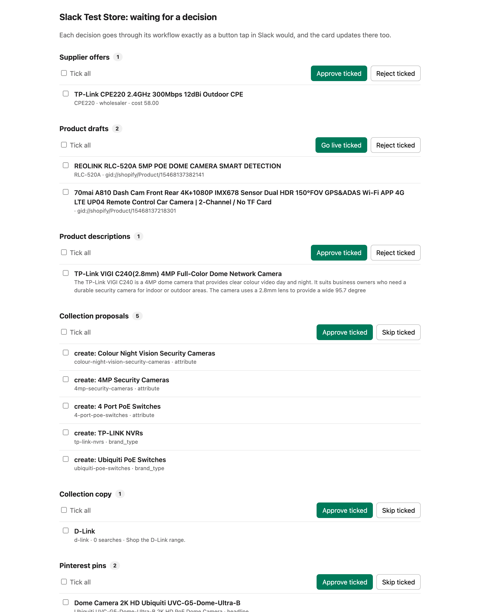

# The Slack-run store

Every workflow from my CMSEO 2026 talk, **The Slack Side Hustle**, wired together into one system. It's the same six phases I built a new store with: products come in from supplier feeds, stay priced and in stock, get enriched with images, specs, descriptions, FAQs and reviews, turn into collections people search for, go out to Google Shopping and social, and every decision lands in Slack as a card you approve with one tap.

The standalone templates in this repo each do one job well. This folder connects them: one Slack app, one Supabase database, one `/store` command, and a conductor that moves each new product from one phase to the next without you tagging anything.



## What's in this folder

| File | What it is |
|---|---|
| `workflows/` | The full plan, 27 workflows in a folder per phase (`0-slack` is the router), ready to import |
| `starter/` | The starter plan: its own 8 workflows, `schema.sql`, `credentials.json` and manifest |
| `supabase/schema.sql` | Every table the full plan uses, plus the `store_queues` view |
| `slack-app-manifest.yml` | One Slack app: the button URL, `/store` and the bot scopes |
| `credentials.json` | Every credential and the nodes it goes on, read by `scripts/create-credentials.py` |
| `config.json` | Your store, your n8n URL, your Slack channels and any setting you change |
| `system.json` | The map: which template is in which phase, which channel each setting posts to, the router's routes, the review queues and the conductor's stages |
| `build.py` | Builds everything above from the templates in this repo and your `config.json`, and imports it with `--import` |
| `src/` | The new workflows (router, conductor, buyer guides, `/store`, review page) before your settings go in |
| `liquid/buyer-guide.liquid` | Shows a collection's buyer guide on a stock theme |

## How it fits together

| Phase | Workflows | Slack channels | What you decide |
|---|---|---|---|
| **1 Publish products** | [Add products](../add-products-to-shopify/), [AI product titles](../ai-product-titles/) | `#log-ingest`, `#review-supplier-offers`, `#review-product-drafts`, `#review-titles`, `#log-publish` | Stock this product? Is the draft ready to go live? |
| **2 Maintain products** | [Inventory and discontinued products](../automated-inventory-management/), [Repricing engine](../shopify-repricing-engine/), [Workflow monitoring](../n8n-workflow-monitoring/) | `#log-inventory`, `#review-discontinued`, `#log-pricing`, `#review-pricing`, `#alerts`, `#digest` | Retire a product that's gone from every feed; apply a big price move |
| **3 Enrich products** | **Conductor**, [Manuals and spec sheets](../product-manuals-spec-sheets/), [Product images](../product-images/), [Product attributes](../product-data-enrichment/), [AI product descriptions](../ai-product-descriptions/), [AI product FAQs](../ai-product-faqs/), [Manufacturer reviews](../manufacturer-reviews/), [Competitor prices](../competitor-price-monitoring/), [Compatible accessories](../compatible-accessories/), [Product videos](../shopify-product-videos/), [Product groups](../shopify-product-groups/) | `#log-sources`, `#log-competitors`, `#review-images`, `#review-attributes`, `#review-descriptions`, `#review-faqs`, `#review-manufacturer-reviews`, `#review-accessories`, `#review-documents`, `#review-videos`, `#log-videos`, `#log-catalogue` | Pick the images, check the specs, approve the copy, FAQs, reviews and videos |
| **4 Enrich collections** | [Collection proposals](../shopify-collections-seo/), [Collection copy](../category-page-seo/), **Buyer guides**, [Collection sorting](../shopify-collection-sorting/), [Internal linking](../ecommerce-internal-linking/) | `#review-collection-proposals`, `#review-collection-copy`, `#review-buyer-guides`, `#log-collections` | Build this collection? Approve its intro and its buyer's guide |
| **5 Distribution** | [Google Shopping feed](../google-shopping-feed-optimization/), [Pinterest pins](../pinterest-automation/), [Instagram posts](../instagram-automation/) | `#review-google`, `#log-google`, `#review-pins`, `#log-pinterest`, `#review-instagram`, `#log-instagram` | Fix a product Google would reject; approve each pin and post |
| **6 Bulk operations** | **Slack command**, **Review page**, **Slack router** | `/store` | Run any job now; approve a hundred cards at once |

The channel names follow one rule: `#review-*` channels hold cards with buttons, one queue per channel, and `#log-*` channels hold information only, so you can mute them. `#alerts` is for failures and `#digest` is one morning summary. Rename any of them in `config.json`.

The bold workflows are new in this folder. The rest are the standalone templates, copied in by `build.py` with your settings filled in, so each one still has its own README and guide that explains how it works.

### What connects them

- **One database.** Every workflow uses the same Supabase (Postgres) database, so the tables that two templates share are the same table: supplier offers feed both publishing and inventory, and the competitor prices that phase 3 collects are what the repricing engine in phase 2 reads. `supabase/schema.sql` creates every table once.
- **One Slack app.** A Slack app can send its button taps to only one URL, and there are 18 workflows with buttons. **Store · Slack router** is that URL. It checks Slack's signature, works out which workflow the card belongs to (by the button's `action_id`, a modal's `callback_id`, then the channel) and passes the tap on unchanged, so each workflow still checks the signature itself, exactly as it would on its own.
- **The conductor.** The phase 3 templates each work on products that carry their tag (`documents`, `needs-images`, `enrich`, `describe`, `faq`, `find-reviews`, `find-videos`). **Store 3 · Conductor** adds those tags in order as each product goes live: sources, images and specs first, then descriptions, FAQs, reviews and videos once the specs are approved, so the copy is written from approved data. A stage ends when its tags are gone and nothing for that product is still waiting in Slack, or after `max_stage_days`.
- **`/store`.** One slash command for the whole store: `/store status` shows what's waiting in every review queue, `/store run <job>` runs any lane of any workflow now instead of waiting for its schedule, and `/store page` opens the review page.
- **The review page.** When the cards pile up, a private link (signed, eight hours) lists every queue with a tick box per item. Approving there doesn't approve anything itself: it reads each card from Slack, builds the same button tap Slack would send, signs it and sends it to that workflow's own webhook. Every decision runs through the workflow's own checks, and the Slack card updates to match.

## Starter or full

You don't have to switch it all on at once. In the talk I built it phase by phase, and that's the best way to set it up too.

- **Starter** (`starter/`, 8 workflows): phases 1 and 2, plus competitor prices so the repricing engine has something to undercut, plus the router, `/store` and the review page. That's a working store that adds products, keeps stock and prices right, and tells you when something breaks. No AI model is needed apart from the product copy in phase 1.
- **Full** (`workflows/`, 27 workflows): all six phases.

Both are built from the same templates, so you can start with the starter and import the rest later.

## What you need

- **n8n**, self-hosted or Cloud, on a public HTTPS URL (Slack has to reach it). Built and tested on n8n 2.48. The Community Edition is free and has no execution limits, which matters here: 27 workflows on schedules run thousands of executions a month, most of which do nothing.
- **Supabase** (or any Postgres). The free plan is enough to start.
- **Shopify**: one Dev Dashboard app with these Admin API scopes: `read_products`, `write_products`, `read_inventory`, `write_inventory`, `read_locations`, `read_publications`, `write_publications`, `read_online_store_navigation`, `write_online_store_navigation`, `read_content`, `read_files`, `write_files`, `read_metaobjects`, `write_metaobjects`, `read_metaobject_definitions`, `write_metaobject_definitions` (and `read_themes` if you turn on internal linking's theme check). [SETUP.md](../SETUP.md#shopify) explains the app and the client credentials grant.
- **Slack**: one app, made from `slack-app-manifest.yml`. The free plan works.
- **An AI model**: Ollama Cloud by default (`gemma4:31b` for copy and vision). Any n8n chat model sub-node can replace it.
- **DataForSEO** for searches and search volumes, about US$15 a month for a store with a few thousand products.
- Only for the workflows that use them: Firecrawl (sites that block plain requests), a YouTube Data API key (product videos), Zernio (Pinterest), an Instagram token (Instagram posts), Google Merchant Center (Shopping feed) and the AliExpress Open Platform (if you list AliExpress products).

## Set it up

### 1. Make it yours

Edit `config.json`: your `store_domain` (the `*.myshopify.com` one), `store_url`, `currency`, `timezone`, your n8n `public_url`, and the `internal_url` n8n uses to reach itself (`http://localhost:5678` for most self-hosted installs). Then build:

```bash
python3 slack-run-store/build.py
```

Add `--plan starter` for the starter set. It rewrites `workflows/`, `supabase/schema.sql`, `credentials.json` and `slack-app-manifest.yml`. You'll come back and fill in the Slack IDs after step 3, then build again.

To change any setting of any workflow, add it under `overrides` in `config.json` rather than editing the workflow, so it survives the next build:

```json
"overrides": {
  "shopify-repricing-engine": { "*": { "dry_run": false, "large_move_pct": 15 } },
  "product-images": { "Find settings": { "batch_size": 20 } },
  "conductor": { "Conductor settings": { "enrol": "all" } }
}
```

The key is the template's folder name (or `conductor`, `buyer-guides`, `router`, `command`, `review-page` for the new workflows), then the settings node's name, then the setting. `*` sets it on every settings node in that workflow that has it, which is what you want for a setting like `dry_run` that several lanes carry. Each template's README lists its settings.

### 2. Create the tables

In Supabase, open the SQL editor, paste `supabase/schema.sql` and run it. It's safe to run again: every table is `create table if not exists`, and it ends with the `store_queues` view that `/store status` reads.

### 3. Create the Slack app and channels

1. At [api.slack.com/apps](https://api.slack.com/apps), click **Create New App**, choose **From a manifest**, pick your workspace and paste `slack-app-manifest.yml`. It sets the button URL (the router), the `/store` command and the bot scopes.
2. **Install to Workspace**. Copy the **Bot User OAuth Token** and, under **Basic Information**, the **Signing Secret**. Note the **App ID** too.
3. Create the channels in Slack (start with phase 1 and 2's) and invite the bot to each: `/invite @Store`.
4. Put each channel's ID (open the channel, click its name, and the ID is at the bottom, starting with `C`) into `config.json`, plus `slack.app_id`, your workspace ID as `slack.team_id`, and the Slack user IDs of everyone who may approve as `slack.approver_ids`. Build again.

Channel IDs matter: the router matches cards by channel, and cards update in place by channel and message, which a `#name` can't do.

### 4. Create the credentials

Run this in your own terminal, from the repo root. It asks for each secret without showing it, sends it straight to your n8n, and makes the `Store run key` (a shared key between your own workflows) by itself:

```bash
python3 scripts/create-credentials.py slack-run-store --supabase
```

For the starter plan, pass `slack-run-store/starter` instead. It lists every node each credential goes on. Skip the optional ones you don't need yet.

### 5. Import the workflows

```bash
python3 slack-run-store/build.py --import
```

Add `--plan starter` for the starter plan. It asks for your n8n URL and an API key (Settings > n8n API), creates every workflow with each credential selected by name, and sets **Workflow monitoring** as every workflow's Error Workflow, so a failure anywhere reaches `#alerts`. Nothing is published. To import by hand instead, open each file in `workflows/` with **Import from File**, select the credentials, and set the Error Workflow in each workflow's settings.

### 6. Switch it on, one phase at a time

1. Publish **Store · Slack router**, **Store 6 · Slack command** and **Store 6 · Review page**. Type `/store` in Slack: you should get the help list.
2. Publish the phase 1 and 2 workflows, then run `/store run setup`. It runs every Setup lane in order (Shopify metafield definitions, webhooks, seed rows).
3. Read each phase 1 and 2 template's README for its settings, and test on a development store first. Every workflow that changes your store starts in `dry_run` or behind a Slack approval.
4. When phase 2 has run cleanly for a few days, publish phase 3 and the conductor. The conductor's `enrol` setting is `new`, so it starts with products that go live from now on. Set it to `all` (in `overrides`, as above) to enrich the products you already have, 250 at a time.
5. Then phase 4, then phase 5. Buyer guides start once a collection's intro has been approved in **Collection copy**.

Every workflow is named `Store <phase> · <job>`, so they sort into phases in n8n's list.

## The new workflows

### Store · Slack router

Your Slack app's Interactivity Request URL. Routes are generated from `system.json` into **Router settings**: a list of `action_id` prefixes (`title_` goes to AI product titles, `retire_` to inventory), modal `callback_id`s, and each review channel's workflow for taps that don't carry a prefix (tick boxes, dropdowns). Link buttons are acknowledged and ignored. A tap with a bad signature gets a 401; one with no route gets an empty 200, so Slack shows nothing. It answers Slack with whatever the workflow answered, which is how a modal shows its validation errors.

### Store 3 · Conductor

Every 15 minutes it enrols live products it hasn't seen, reads the tags of up to `batch_size` products in progress, checks what's still waiting for a decision in each template's table, and adds the next stage's tags. The stages are in `system.json` under `conductor_stages`, and each template's tag is read from that template's own settings, so changing a tag in `overrides` keeps the two in step. Compatible accessories and AI product titles aren't in the stages by default, because they suit some products and not others: tag those products yourself, or add them to a stage.

### Store 4 · Buyer guides

The one step in the talk without a standalone template. Every Tuesday it takes up to `max_per_run` collections whose intro you've approved, highest search volume first, reads their live products' spec metafields, and asks Google's People Also Ask for the questions shoppers have about the collection's keyword. The model writes three or four short sections from those specs only, and a code check flags any number that isn't in the specs, any product it names, and a length outside 200 to 480 words. **Approve** writes it to the collection metafield `custom.buyer_guide`; **Redraft** sends it back for the next run; **Skip** leaves it. To show it on a stock theme, add a **Custom Liquid** block under the product grid on your collection template and paste [`liquid/buyer-guide.liquid`](liquid/buyer-guide.liquid).

### Store 6 · Slack command

`/store help`, `/store status`, `/store page [queue]`, `/store run <job>` and `/store run setup`. Jobs are named after the template and the lane, such as `pricing decide`, `images find` or `guides`; `/store help` lists them all by phase. Running a job calls that workflow's **Run from /store** webhook with the `Store run key` header, which starts the same lane its schedule would. With `approver_ids` set, only those people can run jobs or open the page.

### Store 6 · Review page

Opens from `/store status` or `/store page`. Each queue shows up to 100 items, oldest first. The queues, and the query that lists each one, are in `system.json` under each template's `queues`. Decisions go 10 at a time, one tap every 1.5 seconds, so the cards update in order. An item someone decided in Slack meanwhile is skipped. Anything that needs a choice you haven't made (a video whose coverage is still "uncertain", an image card with nothing ticked) stays in the queue with "Still waiting": open the card in Slack to finish it.

## Keeping it up to date

The workflows in `workflows/` are built from the standalone templates, so a fix to a template reaches the store the next time you build. Pull the repo, run `build.py` again, and import with `--update`. Your settings live in `config.json` and `overrides`, not in the workflows, so nothing you've set is lost.

## Troubleshooting

### Tapping a button does nothing

Open **Store · Slack router**'s executions. No execution means Slack isn't reaching n8n: check the Request URL under **Interactivity & Shortcuts** and that the router is published. An execution that stops at **Routed?** says why in **Pick the workflow**: a bad signature (the wrong signing secret on **Sign the request**) or no route (a channel in `config.json` that doesn't match the card's channel ID). If the router passed it on, the target workflow's own executions say the rest. It must be published too.

### `/store run` says it couldn't start a job

That workflow isn't published, or its **Run from /store** node doesn't have the `Store run key` credential. Both the command and the workflow must use the same credential.

### The conductor isn't moving products

`/store run conductor` and check its run. Products wait while any of their stage's tags are still on them, or while something for them is waiting in a review queue, so the usual cause is a card nobody has decided. After `max_stage_days` they move on anyway and the log line says which tag or queue held them.

### The review page says "Card not found in Slack"

That queue's card was deleted, or the bot can't read the channel. The page reads cards with `conversations.history`, which needs the bot in the channel and the `channels:history` scope (`groups:history` for private channels). The manifest includes both; if you made the app another way, add them and reinstall.

### Two templates sort my collections

Collection copy (category page SEO) has its own daily sort. In the full plan it's switched off, because **Collection sorting** owns the order. In the starter plan neither runs.

## Set it up with an AI agent

Paste this into Claude Code, Codex or Cursor, opened in a clone of this repo. It never needs your secrets: you type those into a script in your own terminal.

```text
Help me set up the Slack-run store in ./slack-run-store: the n8n templates in this repo wired into one system, run from Slack.

1. Read slack-run-store/README.md, SETUP.md, slack-run-store/config.json and slack-run-store/system.json. Ask me whether I want the starter plan (phases 1 and 2) or the full plan, and which phases I want to switch on first.
2. Fill in config.json with me one value at a time: my store domain, store URL, currency, timezone, my n8n public URL and the URL n8n reaches itself on. Then run: python3 slack-run-store/build.py (add --plan starter for the starter plan).
3. Tell me to run supabase/schema.sql in Supabase's SQL editor, and wait until I say it's done.
4. Walk me through creating the Slack app from slack-app-manifest.yml, creating the channels for the phases I chose, and inviting the bot. Ask me for each channel ID, the app ID, my workspace ID and the approvers' user IDs, put them in config.json and build again.
5. Never ask me for a password, token, API key or secret, and don't accept one if I paste it. Tell me to run this in my own terminal from the repo root:
   python3 scripts/create-credentials.py slack-run-store --supabase
6. Tell me to run python3 slack-run-store/build.py --import in my own terminal (it asks for my n8n API key itself), or import the workflows with the n8n MCP server if one is connected.
7. Publish the router, the Slack command and the review page, and have me type /store in Slack. Then publish phase 1 and 2 only and have me run /store run setup.
8. For each workflow in the phases I chose, read its template's README and walk me through its settings one at a time. Put any change in config.json under overrides, never in the workflow, and build again.
9. Test on a development store with dry_run on: run each job with /store run, show me what it produced and check it with me before anything writes to my live store.
10. Stop and ask me whenever something doesn't match the README.
```
